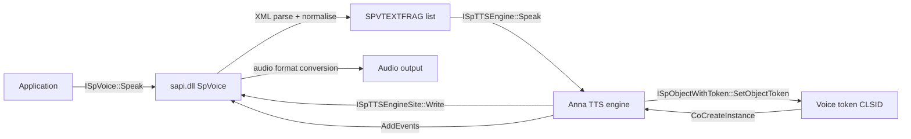

# 1. SAPI 5 host contract (external, documented)

This section is the stable interface the Anna engine plugs into. It is derived from
Microsoft's archived SAPI 5.3 documentation, not from the binaries. Binary-specific
findings appear in later sections.

Sources:
- TTS Engine Vendor Porting Guide: https://learn.microsoft.com/en-us/previous-versions/windows/desktop/ms717037(v=vs.85)
- `ISpTTSEngine`: https://learn.microsoft.com/en-us/previous-versions/windows/desktop/ms719558(v=vs.85)
- `ISpTTSEngineSite`: https://learn.microsoft.com/en-us/previous-versions/windows/desktop/ms719560(v=vs.85)
- `ISpObjectWithToken`: https://learn.microsoft.com/en-us/previous-versions/windows/desktop/ms718356(v=vs.85)
- Object tokens and registry settings: https://documentation.help/SAPI-5/tokensandregistrysettings.htm

## 1.1 Object graph



The application never talks to the engine directly. SAPI creates the engine from the
voice token's `CLSID`, hands it the token through `ISpObjectWithToken::SetObjectToken`,
then calls `ISpTTSEngine::GetOutputFormat` and `ISpTTSEngine::Speak`. The engine writes
PCM (or its declared format) and events back through `ISpTTSEngineSite`.

## 1.2 Voice token (registry)

Voices live under:

```
HKLM\SOFTWARE\Microsoft\Speech\Voices\Tokens\<TokenName>
```

Required/typical values:

| Value | Meaning |
|---|---|
| `(Default)` | language-independent display name |
| `<hex LangID>` (e.g. `409`) | localized display name |
| `CLSID` | COM class of the engine object |
| `Attributes\Language` | `;`-separated LCIDs |
| `Attributes\Gender` | `Male` / `Female` |
| `Attributes\Age` | `Adult` / `Child` |
| `Attributes\Vendor` | vendor string |
| `Attributes\Name` | display name |
| `Attributes\Version` | engine/voice version |
| `Attributes\AudioFormats` | supported format bitmask (e.g. `6`) |

Engine-specific data references (`VoiceData`, `VoiceDef`, `LangDataPath`,
`VoicePath`, `Lex`, `LTS`) are ordinary values/subkeys interpreted by the engine
after `SetObjectToken`. They are not part of SAPI itself.

## 1.3 Engine interfaces

### `ISpObjectWithToken` (implemented by engine)

| Slot | Method | Role |
|---|---|---|
| 0-2 | `IUnknown` | `QueryInterface`, `AddRef`, `Release` |
| 3 | `SetObjectToken(ISpObjectToken*)` | receive voice token; load voice files/state |
| 4 | `GetObjectToken(ISpObjectToken**)` | return token |

### `ISpTTSEngine` (implemented by engine)

| Slot | Method | Role |
|---|---|---|
| 0-2 | `IUnknown` | |
| 3 | `GetOutputFormat(const GUID*, const WAVEFORMATEX*, GUID*, WAVEFORMATEX**)` | negotiate output format; return closest supported |
| 4 | `Speak(DWORD flags, REFGUID fmt, const WAVEFORMATEX*, const SPVTEXTFRAG*, ISpTTSEngineSite*)` | render text and write audio/events |

`Speak` returns when the fragment list is consumed or the site requests an abort.
Flags passed to the engine are only `0` or `SPF_NLP_SPEAK_PUNC`; all other
`SPEAKFLAGS` are handled by SAPI.

### `ISpTTSEngineSite` (implemented by SAPI, used by engine)

Inherits `ISpEventSink`. Vtable order after `IUnknown`:

| Method | Role |
|---|---|
| `GetEventInterest` | which event types the client wants |
| `AddEvents` | queue `SPEVENT` records (word/sentence/phoneme/viseme boundaries) |
| `GetActions` | poll for abort/skip/rate/volume changes |
| `Write(const void*, ULONG, ULONG*)` | enqueue rendered audio bytes |
| `GetRate` | current rate adjustment |
| `GetVolume` | current volume (0-100) |
| `GetSkipInfo` | skip request (type, count) |
| `CompleteSkip` | acknowledge skip |

## 1.4 Input fragments

SAPI performs XML parsing and passes a linked list of `SPVTEXTFRAG`:

```c
typedef struct SPVTEXTFRAG {
    struct SPVTEXTFRAG *pNext;
    SPVSTATE            State;
    LPCWSTR             pTextStart;
    ULONG               ulTextLen;
    ULONG               ulTextSrcOffset;
} SPVTEXTFRAG;

typedef struct SPVSTATE {
    SPVACTIONS      eAction;      // Speak, Silence, Pronounce, Bookmark, SpellOut, ...
    LANGID          LangID;
    WORD            wReserved;
    long            EmphAdj;
    long            RateAdj;
    ULONG           Volume;
    SPVPITCH        PitchAdj;     // MiddleAdj, RangeAdj
    ULONG           SilenceMSecs;
    SPPHONEID      *pPhoneIds;    // for SPVA_Pronounce
    SPPARTOFSPEECH  ePartOfSpeech;
    SPVCONTEXT      Context;      // pCategory, pBefore, pAfter
} SPVSTATE;
```

Consequences for reimplementation:

- Text normalization, tokenization, lexicon lookup, letter-to-sound, prosody and
  unit selection are **engine** responsibilities.
- SAPI owns XML, audio device, format conversion, skip/abort, and event delivery.
- An engine can therefore be exercised with a synthetic `ISpTTSEngineSite` that
  captures PCM and events, without a sound card.
