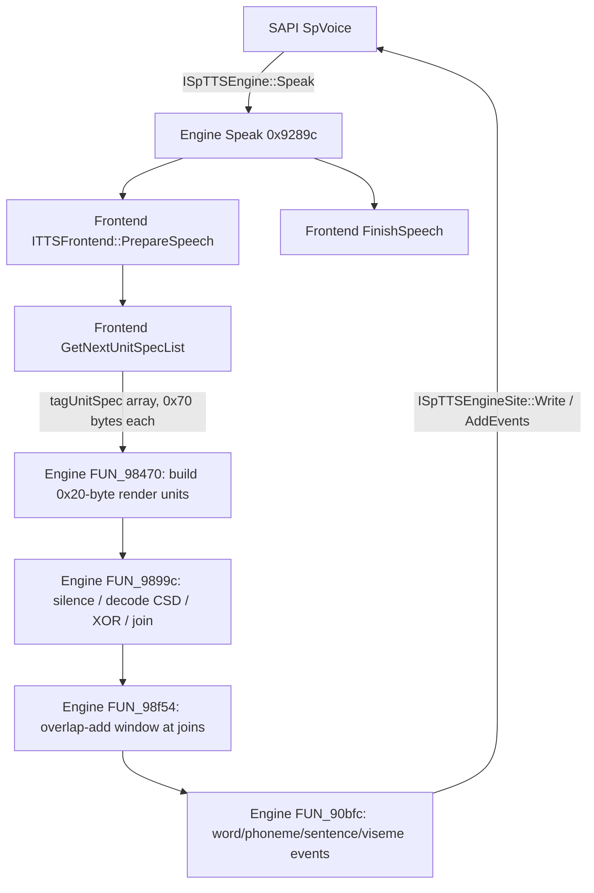

# 3. Anna engine and frontend architecture

All addresses are virtual addresses in the extracted 64-bit binaries:
`MSTTSEngine.dll` base `0x7ff31780000`, `MSTTSFrontendENU.dll` base
`0x7ff360a0000`. Decompiled C is in `out/decomp/engine64/` and
`out/decomp/frontend64/`; file names start with the function address.

## 3.1 End-to-end pipeline



`Speak` is synchronous from SAPI's point of view, but the engine owns a render
thread. It double-buffers unit lists, fills the next list on the caller thread,
and the worker renders the current list while the next is prepared.

## 3.2 Engine COM object

Coclass `TTSEngine` `{F51C7B23-6566-424C-94CF-2C4F83EE96FF}` is registered by
`MSTTSEngine.dll`. `DllGetClassObject` (`0x915cc`) looks up a one-entry class table;
the entry is created by `FUN_7ff317a1ae4` (`out/decomp/engine64/`).

The non-aggregated engine object is 0x110 bytes (`FUN_7ff31790470`); the aggregated
path is 0x128 bytes (`FUN_7ff317905d8`). Interface vtables in the non-aggregated
object:

| Object offset | Interface | Vtable | Notes |
|---:|---|---|---|
| 0 | `ISpTTSEngine` | `0x7ff3178bc68` | `Speak` slot 3, `GetOutputFormat` slot 4 |
| 8 | `ISpObjectWithToken` | `0x7ff3178bc98` | `SetObjectToken`, `GetObjectToken` |
| 16 | `ITTSSupportDebug` | `0x7ff3178bcc0` | `GetSupportedTypes`, `SetDebugger` |
| 24 | `ISpEnginePronunciation` | `0x7ff3178bce8` | `Normalize`, `GetPronunciations` |

`Speak` = `FUN_7ff3179289c`, `GetOutputFormat` = `FUN_7ff317929dc`,
`SetObjectToken` = `FUN_7ff3179284c`.

Observed object fields (offsets from the `ISpTTSEngine` pointer):

| Offset | Meaning (evidence) |
|---:|---|
| `+0x58` | `ITTSFrontend*` (created from token `Frontend`) |
| `+0x70` | `ISpTTSEngineSite*` for the current `Speak` |
| `+0x78` | voice renderer object (created by `FUN_7ff31798254`) |
| `+0x80` | stream offset accumulator used for event timestamps |
| `+0x88` | current `SPVTEXTFRAG*` list |
| `+0x90` | output format ID selected at init (Anna: `0x12`) |
| `+0x94` | `DefaultRate` from token |
| `+0xa0`, `+0xa8` | two unit-list buffers (double buffer) |
| `+0xb0` | prosody/PSOLA object: allocates pitch buffers, sets sample rate (`FUN_7ff317948ec`) and rate factor (`FUN_7ff31794894`) |
| `+0xb8` | `WAVEFORMATEX`-like output description |
| `+0xc0`, `+0xc4` | abort flag / error code |
| `+0xf0` | render thread handle (`_beginthreadex`) |
| `+0xf8`, `+0x100` | work/no-work auto-reset events |
| `+0xc8` | critical section protecting unit lists (decimal 200 in decompilation) |

## 3.3 Initialization (`SetObjectToken`)

`FUN_7ff3179284c` stores the token, then calls `FUN_7ff3179322c`:

1. Creates two unit-list objects at `+0xa0`/`+0xa8`.
2. Reads token string `Frontend` (string value, line 64 of the decompilation).
3. `CLSIDFromString` + `CoCreateInstance(..., IID_ITTSFrontend)` and calls
   `ITTSFrontend::Initialize(token)` (frontend vtable `+0x18`).
4. Calls `FUN_7ff31797484(token)` to load voice data and create the renderer.
5. Reads token DWORD `DefaultRate`; clamps it to `[-20, 20]`; converts it to a
   linear factor with `pow(3.0, rate / 10.0)` and applies it to the prosody/PSOLA object.
6. Initializes the output format from the voice header: sample rate 16000, channels
   1, 16-bit, and sets `+0x90 = 0x12` (Anna's `AudioFormats` attribute is also 18).

`ITTSFrontend::Initialize` is frontend `FUN_7ff360b8e48`:

- reads `VoicePath` and `VoiceName`, builds the uppercase path
  `<VoicePath>\<VoiceName>`;
- gets/creates a cached voice context (`FUN_7ff360c032c`) keyed by that path;
- loads the frontend data object (`FUN_7ff360c054c`) and stores it at
  frontend `+0xb0`/`+0x110`;
- stores the context at `+0x118`.

## 3.4 Voice data load and selection

`FUN_7ff31797484` (engine):

1. `GetStringValue("VoicePath")`, `GetStringValue("VoiceName")`.
2. Builds `<path>\<name>` (uppercases it), then `%s.WIH`.
3. Opens the file with `CreateFileW` and reads **16 bytes**.
4. Parses the 16-byte header into a 12-byte voice-info record:
   - byte `+0` = 3 (format selector),
   - `u32 +4` = 16000 (sample rate),
   - `u16 +8` = 2 (bytes per sample),
   - `u16 +10` = 1 (channels),
   - byte `+12` = 0.
5. Uses process-wide caches `DAT_7ff317a6d00` and `DAT_7ff317a6d08` keyed by that
   record, then creates the renderer with `FUN_7ff31798254`.

`FUN_7ff3179a3b4` selects the acoustic container by the voice-info format byte:

| Condition | Container | Object vtable |
|---|---|---|
| selector 1, flag `+0x254 == 0` | `%s.WVE` (uncompressed wave) | `0x7ff3178c140` |
| selector 3, flag `+0x254 == 0` | `%s.CSD` + `%s.IDX` (compressed speech) | `0x7ff3178c170` |
| flag `+0x254 != 0` | `%s.WIH` wave inventory | `0x7ff3178c1a0` |

Anna's voice info has selector 3, and the WIH flag is also set, so both the CSD/IDX
object and the WIH object are created. The `.CSD` object owns the decoder.

`FUN_7ff31799958` loads the linguistic tables, in order:

```
%s.APL  -> FUN_7ff3179d238
%s.UNT  -> FUN_7ff31799a94
%s.CRT  -> FUN_7ff31799d78
```

Failure rolls back the whole voice load. `%s.WVE` is referenced but not shipped for
Anna.

## 3.5 Decoder bridge

`FUN_7ff3179a958` (`.CSD` initialize) does not decode in-process:

- `CoCreateInstance(CLSID {3F6B5E16-092A-41ED-930B-0B4125D91D4E}, IID IDecObj ...)`;
  this is `MSTTSDecWrp.DecObj`.
- 32-bit process: `CLSCTX_INPROC_SERVER` (1).
- 64-bit process: `CLSCTX_LOCAL_SERVER` (4), then the returned interface is placed
  in the **Global Interface Table** (CLSID `{00000323-...}`, IID `{00000146-...}`)
  so the render thread can use it.

`HKLM\SOFTWARE\Classes\AppID\{3F6B5E16-092A-41ED-930B-0B4125D91D4E}` is
`MSTTS DecObj Class Surrogate` with an empty `DllSurrogate` value. The engine uses
the same GUID as the DecObj CLSID and requests `CLSCTX_LOCAL_SERVER` in 64-bit
mode. `[INFERENCE]` the 32-bit `MSTTSDecWrp.dll` is therefore activated in the
system surrogate host; the offline hive does not contain an InprocServer32 entry
for that CLSID.

`MSTTSDecWrp.dll`:

- `IDecObj::Initialize(BSTR csdFile, BSTR idxFile)` loads the CSD/IDX pair.
- `IDecObj::ReadBSTR(start, length)` returns a `SAFEARRAY` of 16-bit PCM
  (`vt = 0x2011`, `VT_ARRAY | VT_UI2`).
- The codec is `WMSpeech Decoder DMO`,
  CLSID `{874131CB-4ECC-443B-8948-746B89595D20}`, `InprocServer32 = WMSPDMOD.DLL`.
- Each compressed block is XOR-obfuscated before decoding. The key is the 128-byte
  string below; the engine indexes modulo `0x81` (the NUL terminator is index 128):

```
wyClImqDdiZXo70AojxIgiuuUyaR2iZ1ibjHbPfShaPJdRcRCa1i9b6ELZEOQRPWSOzA8SwpvfSCJR0XhzeyuNClPut80OJVSyHirCHyVp1egkunuTG2HzOROvXY5ukw
```

`FUN_41508303` reads fixed-size blocks at file offset `blockSize * index`, XORs
`blockSize` bytes with the key, timestamps the block as
`index * 10,000,000 / 16000` (100 ns units), and feeds it to the DMO.

## 3.6 Output formats

`GetOutputFormat` (`FUN_7ff317929dc`):

- If the requested format GUID is `SPDFID_Text`
  `{7CEEF9F9-3D13-11D2-9673-794FC000E79E}`, it returns Text and a null waveform.
- Otherwise it calls `FUN_7ff31794364(+0x90, ...)`, which builds a `WAVEFORMATEX`
  from the format ID.

For Anna, `+0x90 = 0x12` → 16 kHz, 16-bit, mono. The function also supports a set
of SAPI stream-format IDs (4..0x27, 0x28, 0x29.., 0x31.., 0x39.., 0x41..) using
rate tables at `0x7ff3178bf10`/`0x7ff3178bfc8`.

`Speak` accepts `SPDFID_WaveFormatEx` `{C31ADBAE-527F-4FF5-A230-0A2ACF71FB62}` or
`SPDFID_Text`; anything else returns `SPERR_UNSUPPORTED_FORMAT` (`0x800...`).

## 3.7 Render loop

`Speak` (`FUN_7ff3179289c`):

1. Stores the fragment list (`+0x88`) and output site (`+0x70`).
2. Calls `ITTSFrontend::PrepareSpeech(fragments, flags, site)`.
3. Calls `FUN_7ff31792a58`.
4. Calls `ITTSFrontend::FinishSpeech()`.

`FUN_7ff31792a58`:

- fills buffer A via `FUN_7ff31793064`, which calls
  `ITTSFrontend::GetNextUnitSpecList(&list, &count, &state, &skip)` and then
  `FUN_7ff31798470` to convert the frontend's 0x70-byte specs into 0x20-byte render
  units;
- swaps A/B and signals the worker (`+0xf8`);
- waits on the idle event (`+0x100`);
- checks `ISpTTSEngineSite::GetActions` for abort;
- repeats until the frontend returns state 1 (done) or `Speak` is aborted.

The worker (`FUN_7ff31792ee4`) consumes the filled list and calls
`FUN_7ff317938a0`, which invokes `FUN_7ff3179899c` per batch.

## 3.8 Unit rendering

`FUN_7ff3179899c` operates on 0x20-byte render units. Per unit:

| Unit offset | Use |
|---:|---|
| `+0x00` | `u16` type: 0 = silence, nonzero = speech |
| `+0x04` | decoder/DB index or length |
| `+0x08` | byte/word position |
| `+0x0c` | sample count (silence) or decoded length |
| `+0x10` | source/event position |
| `+0x14` | event field |
| `+0x18` | event field |
| `+0x1c`, `+0x1d` | join flags (left/right overlap eligibility) |

Silence units generate zero PCM and SAPI word-position bookkeeping. Speech units:

1. ask the decoder (`param_1+0x40`, vtable `+0x18`) for the unit's decoded data;
2. XOR the decoded bytes with a fixed 32-byte mask
   (`0x7ff317a64d8`: `36 9d 0e 85 0b 5a 5a 51 c1 4e 2e 83 b6 e4 b1 b7
   94 2e 2e 88 08 de a9 fb 9f 57 6b 7b e4 eb 76 38`);
   `[UNKNOWN]` whether this is a watermark, an anti-copy transform, or part of the
   unit encoding; the code applies it unconditionally after decode;
3. concatenate into the PCM buffer;
4. apply the join window through `FUN_7ff31798f54`.

`FUN_7ff31798254` builds the join window: length 200 samples at 16 kHz
(`cosf(i * pi / (N-1) - pi/2)` over the first half). `FUN_7ff31798f54` applies the
window to the first and last `N/2` samples of adjacent speech units when the join
flags allow it. This is a linear overlap-add crossfade, not PSOLA.

Events: `FUN_7ff31790bfc` walks the unit's 0x20-byte event array
(`m_pEventArray`, count `m_nNumOfEvents`). It emits:

| Event type | Meaning |
|---:|---|
| 5 | word boundary |
| 6 | phoneme |
| 7 | sentence boundary |
| 8 | viseme |

It computes `ullAudioStreamOffset` from the accumulated sample position and the
output format's block alignment (`(u16 at outFmt+0xe) >> 3`), then calls
`ISpTTSEngineSite::AddEvents`.

## 3.9 Frontend architecture

Coclass `MSTTSFrontendENU` `{55DFB4F7-4175-4B3B-B247-D9B399ADB119}` implements
`ITTSFrontend` and `ITTSSupportDebug`. The `ITTSFrontend` subobject lives at object
offset `+0x18` with vtable `0x7ff360a6540`:

| Vtable | Method | Address |
|---:|---|---|
| `+0x18` | `Initialize(ISpObjectToken*)` | `FUN_7ff360b8e48` |
| `+0x20` | `PrepareSpeech(frags, flags, site)` | `FUN_7ff360b92a0` |
| `+0x28` | `FinishSpeech()` | `0x7ff360b9304` (tiny stub: `xor eax,eax; cmp [rcx+0x108],rax; sete al; ret`) |
| `+0x30` | `GetNextUnitSpecList(...)` | `FUN_7ff360b9318` |
| `+0x38` | `Normalize(...)` | `FUN_7ff360bed4c` |
| `+0x40` | `GetPronunciations(...)` | `FUN_7ff360bed88` |

`PrepareSpeech` calls the internal parser's reset (`+0xb0` vtable `+0x18`), clears
the unit list, stores the output site, and resets prosody state.

`GetNextUnitSpecList` applies skip counts, calls `FUN_7ff360bcdec` to produce a
batch, allocates a 0x70-byte spec array, posts events per unit
(`FUN_7ff360be260`), and returns the array, count, state and skipped count.

### Text-to-unit pipeline (`FUN_7ff360bcdec`)


- `FUN_7ff360bc420` (463 lines) scans the `SPVTEXTFRAG` text, allocates 0x6a0-byte
  word records, handles punctuation/space, and calls `FUN_7ff360bb410` for word
  analysis. `[INFERENCE]` this is the tokenizer/normalizer stage; it is the only
  stage that consumes `pTextStart`/`ulTextLen`.
- `FUN_7ff360bd094` and `FUN_7ff360bd26c` walk the word list and perform
  lexicon/pronunciation resolution through the hash tables at frontend `+0x78`
  (`FUN_7ff360c06e8`, `FUN_7ff360c069c`). `[INFERENCE]` they are the
  pronunciation/lexicon stages; the exact split is unresolved.
- `FUN_7ff360b96bc` operates on a hash/index structure (`FUN_7ff360d2f14`) and
  prepares the unit-search candidates.
- `FUN_7ff360b9bd8` selects units from 0x50-byte candidate records at `+0xd0`,
  using context and boundary conditions; it can fall back to a special unit path
  (`FUN_7ff360b9e64`).
- `FUN_7ff360bd8f8` emits the final `tagUnitSpec` array. It maps phone features to
  stress/pitch values via the table at `L"=(= = = ="` (LCID 0x409 only), attaches
  event records (`FUN_7ff360bef60`), handles bookmark/`_sil_` units, and sets the
  unit source range fields.

`Normalize` (`FUN_7ff360be618`) and `GetPronunciations`
(`FUN_7ff360bed88`) expose the same normalization/pronunciation engine to SAPI's
`ISpEnginePronunciation` interface.

### Frontend data

`ITTSFrontend::Initialize` loads a per-voice context. The loader at
`FUN_7ff360c054c` allocates a 0x200-byte data object; `FUN_7ff360cd6cc` builds the
phoneme/symbol tables. That function installs:

- 177 entries in the first table (`DAT_7ff360ede18`),
- 71 entries in the second (`DAT_7ff360f1b48`),
- 42 entries in the third (`DAT_7ff360f3408`),

plus special allophone pairs such as `L"ah 2 v & ax 2 &"` and
`L"ah 2 v & ax 2 n &"`. These are the English phoneme inventory and context
allophones used by unit lookup.

`FUN_7ff360d2898` appends `.LTS` to the voice path; `MSTTSCommon.dll` implements
`ILTS` (`{A0278C53-9ABF-4C9E-8903-2E86BC989B62}`) with `Initialize`, `Free`,
`GetPronunciation`. `MSTTSCommon!FUN_7ff25bd581c` parses the `.LTS` file.

## 3.10 File-format notes (evidence-based)

### `.WIH` (wave inventory header)

16-byte header observed for Anna:

| Offset | Type | Value | Meaning |
|---:|---|---:|---|
| 0 | u32 | 0 | version/reserved |
| 4 | u8 | 3 | format selector (matches engine byte 3) |
| 8 | u32 | 16000 | sample rate |
| 12 | u16 | 2 | bytes per sample |
| 14 | u16 | 1 | channels |

After the header is the inventory data. The WIH reader (`FUN_7ff3179ad48`) seeks to
`offset + 0x10` and reads a requested byte count; the first samples are `int16`
values. `[UNKNOWN]` the exact record layout; it is used for unit boundaries and/or
pitch/energy, not for decoding CSD audio.

### `.CSD` + `.IDX`

The pair is a complete, self-describing WMSpeech container. `MSTTSDecWrp!FUN_4150877e`
(`IDecObj::Initialize`) reads the IDX header and builds the block table:

```
IDX:
  u32  headerSize              // 72 for Anna
  u16  blockSize               // 450 = nBlockAlign
  u16  formatSize              // 64
  u8   format[formatSize]      // WAVEFORMATEX (18 bytes) + 46 bytes codec data
  u16  decodedLength[count]    // count = (fileSize - headerSize) / 2
```

Anna values:

| Field | Value |
|---|---|
| `headerSize` | 72 |
| `blockSize` | 450 |
| `formatSize` | 64 |
| `WAVEFORMATEX.wFormatTag` | `0x000A` (WMSpeech) |
| channels / rate / bits | 1 / 16000 / 16 |
| `nAvgBytesPerSec` / `nBlockAlign` | 1500 / 450 |
| `cbSize` | 46 |
| blocks | 66,218 |
| decoded samples (sum of lengths) | 635,637,906 (39,727 s) |

`CSD` is exactly `blocks * blockSize` = 29,798,100 bytes: 66,218 consecutive
450-byte blocks. Block `i` is at file offset `blockSize * i`; `FUN_41508303` reads
450 bytes, XORs them with the 129-byte key (128 bytes + NUL, index modulo `0x81`),
timestamps the block as `i * 10,000,000 / 16000`, and feeds it to the DMO. The
`decodedLength[i]` values are cumulative PCM offsets used by `ReadBSTR`.

`IDecObj::ReadBSTR` returns a `SAFEARRAY` of 16-bit PCM (`VT_ARRAY | VT_UI2`,
`0x2011`).

### `.LTS`

`MSTTSCommon!FUN_7ff25bd581c` reads, in order:

1. `u32 totalSize`;
2. `u32 count1`, then `count1 * u32` (offsets/IDs);
3. `u32 count2`, then `count2` bytes;
4. padding to the `totalSize` boundary;
5. further `(count, byte/offset array)` blocks;
6. a final block of `u32` values.

`[INFERENCE]` this is a serialized rule/trie table for letter-to-sound; the
pronunciation strings observed in the file (`aa1 r`, `ae n d`, `ah1 sh`,
`ao ax`, ...) are the output alphabet.

### `.UDT`, `.APL`, `.UNT`, `.CRT`, `.TTS`

| File | Evidence | Role |
|---|---|---|
| `.UDT` | magic `UDT\0`, version 1, LCID 0x409; UTF-16 phone strings (`aa+l`, `ae+d`, ...) | unit/phone data table |
| `.APL` | loader `FUN_7ff3179d238`; header `u32 1,1,0x100` | application/rule table (`[UNKNOWN]` exact semantics) |
| `.UNT` | header `u32 1,0x100,0x105`; loader `FUN_7ff31799a94` | unit-name or normalization table |
| `.CRT` | header `u32 0x7fd48,0x100,0xdf8,0xef8`; loader `FUN_7ff31799d78` | context/rule table (`[UNKNOWN]`) |
| `.TTS` | token `Lex\DataFile`, `SpCompressedLexicon` CLSID | SAPI compressed lexicon, loaded by `sapi.dll`, not the acoustic engine |

## 3.11 Reimplementation specification

A faithful architecture-level reimplementation needs:

1. **SAPI host**: `ISpTTSEngine`, `ISpObjectWithToken`, `ISpTTSEngineSite`, token
   parsing (`Frontend`, `VoicePath`, `VoiceName`, `DefaultRate`, `VoiceData`).
2. **Frontend**: text scanner/normalizer, lexicon, LTS, pronunciation/context
   lookup, phoneme inventory, prosody/break assignment, unit selection.
3. **Unit database**: `tagUnitSpec` producer and the 0x50-byte candidate records
   used by `FUN_b9bd8`.
4. **Decoder**: XOR de-obfuscation + WMSpeech DMO (or a compatible decoder) for
   `.CSD`; `.IDX` block index; 16 kHz mono PCM.
5. **Renderer**: 0x20-byte render units, silence generation, overlap-add window
   (200 samples at 16 kHz), event queue with SAPI word/phoneme/sentence/viseme
   events, stream-offset accounting.
6. **Threading**: producer thread (frontend) + render thread, double-buffered unit
   lists, two events and one critical section.

### Feasibility

The control architecture is fully recoverable: interfaces, object layout, data
paths, file loaders, decoder identity, XOR transform and join algorithm are all
documented above. A clean-room reimplementation of the *architecture* is feasible.

Bit-exact **voice reproduction is not** established and is out of scope per the
project constraint: the acoustic units live in the proprietary `.CSD` corpus and are
encoded with the proprietary WMSpeech codec; no voice was recreated here.

## 3.12 Residual unknowns

- Exact semantics of `.APL`, `.UNT`, `.CRT` records and of the `.WIH` post-header
  payload.
- Which of `FUN_7ff360bd094`/`FUN_7ff360bd26c` is lexicon lookup vs. phonological
  rule application.
- The unit-selection cost function in `FUN_7ff360b9bd8` (it uses features and
  boundaries but the weights are not yet labelled).
- Whether the 32-byte PCM XOR mask is an anti-copy transform or part of the unit
  encoding.
- Full `FinishSpeech` contract (`0x7ff360b9304` returns a boolean derived from
  `[this+0x108]`; its caller-visible meaning is unresolved).
